<div align="center">


<h1>ArcMD</h1>

**A fresh take on the Markdown editor. Native, expressive, and built around your spaces.**

[简体中文](README.md) · English

<a href="mygo.json"></a>

<a href="https://github.com/egoist/mygo"></a>
<a href=".github/workflows/build.yml"></a>
<a href="LICENSE"></a>


[](https://awesomemygo.dev/apps/arcmd)

<br><br>



<br><br>

<a href="https://github.com/Ciao1019/ArcMD/releases"></a>
<a href="https://github.com/Ciao1019/ArcMD/releases"></a>
<a href="https://github.com/Ciao1019/ArcMD/releases"></a>

<sub>The current preview version is 0.0.2. The buttons open the releases page; you can also <a href="#build-from-source">build from source</a>.</sub>

<br><br>

[Highlights](#highlights) · [Features](#features) · [Performance](#performance) · [Build from source](#build-from-source) · [Contributing](#contributing)

</div>

<br>

> **Tribute & Origin**
>
> The day The Browser Company announced Arc was entering maintenance mode, countless voices on X mourned the twilight of a piece of software crafted with so much taste, tactile delight, and soul.
>
> As a longtime devotee of Arc, I couldn't bear to let go of what had fundamentally reshaped my workflow: the vertical sidebar, vibrant Spaces, effortless Favorites, and that calm, breathing canvas. Since Arc has paused its journey, we chose to carry its spirit forward into document editing with pure Go and Native UI — no Electron, no Webview, just pure native performance and the uncompromised joy of Arc's interactions.
>
> ArcMD is dedicated to every creator who still believes that software should have craft, feel, and soul.

ArcMD brings Markdown's familiar writing flow to a rich-text canvas, with a
workspace inspired by [Arc](https://arc.net/): a vertical sidebar, colorful
spaces, favorites, and a quiet page that puts your words first. Keep a journal,
develop an idea, or organize an entire project in a place that feels like yours.

**Built entirely in Go with [MyGo](https://github.com/egoist/mygo)'s Native UI.**
MyGo provides native windows, GPU drawing, text shaping, and system input;
ArcMD builds its own document engine and rich-text editor on top. The interface
is drawn directly from Go, with no HTML, JavaScript, WebView, Electron, or cgo.

> [!NOTE]
> **ArcMD is still young.** It's an early preview, and plenty is unfinished — the editor in particular is still fairly basic and improving one step at a time.
> If you like where it's heading, share bugs and ideas in [Issues](https://github.com/Ciao1019/ArcMD/issues) or send a pull request. We'd love to build it together.

## Highlights

### A space for every part of your life

Each space is a folder with its own name, icon, and color theme — one, two, or
three colors with a touch of grain. Swipe with two fingers on the sidebar, or
press <kbd>⌃1</kbd>…<kbd>⌃9</kbd>, and the whole window glides into the next
space. Every space remembers the page you left open there; favorites stay with
you wherever you go.

### The Library: all your spaces at a glance

<p align="center"></p>

Click the Library button in the corner, or press <kbd>⇧⌘L</kbd>. The sidebar
widens into a card for every space, each painted in its own colors, with its
folders ready to open. Pick any page to jump straight into it. Plugins and
recently deleted files live here too.

### A sidebar that steps aside

<p align="center"></p>

Press <kbd>⌘ &#92;</kbd> and the page takes the whole window. When you need your
files, move the pointer to the left edge: the sidebar slides out over the page,
and tucks itself away as soon as you move on. In narrow windows it collapses on
its own.

## Features

### Write on a rich-text canvas

- **Rich formatting** — headings, bold, italic, underline, strikethrough, links,
  inline code, text colors, and highlights. Select text to reveal a floating
  toolbar; use `/` to insert a block.
- **More than paragraphs** — nested lists, tasks, quotes, colored callouts,
  code blocks, images, TeX formula blocks, editable tables with merged cells,
  and two-column layouts.
- **A document with structure** — a navigable outline, collapsible headings
  and lists, draggable blocks and sections, page icons, and image or gradient
  covers.
- **Bring your content along** — import and export Markdown, paste rich content
  from webpages and document apps, and export pages to PDF.

### Give every project its own space

- **Spaces** — separate folders for work, life, and projects, each with its own
  name, icon, and light or dark color theme. Switch with a trackpad swipe or a
  keyboard shortcut.
- **Favorites and pins** — keep favorites across spaces and pin documents or
  folders within a space. Drag to reorder, organize, or move between spaces.
- **Split views** — work with up to four documents at once, with resizable panes
  and independent cursors, scrolling, and undo histories.
- **Quick navigation** — a command bar, full-text search, document previews,
  folder previews, and back/forward history keep your work close at hand.

### Connect ideas and stay in flow

- **Linked notes** — connect documents with `[[wiki links]]`, see backlinks,
  and browse `#tags`. Renaming a document updates links to it.
- **Focused writing** — a distraction-free mode, optional paragraph dimming,
  typewriter scrolling, and customizable keyboard shortcuts.
- **Local ownership** — documents and attachments stay in your folders.
  Autosave, version history, external-change detection, and a 30-day recently
  deleted collection help you recover your work.

### A small core, room to extend

AI writing, translation, and sync are planned as optional plugins. The manifest,
installer, and host interfaces are in place; plugin runtimes and the marketplace
are still in development. See the [plugin roadmap](docs/plugins.md).

## Performance

CPU frame processing time over **100 consecutive operations** of each type in a
mixed document of **1 million characters and 549 chapters**, including 500 tables
and 9,912 table cells. Each case runs in three fresh processes; the table reports
the median of the three per-run P50 and P95 values.

| Operation | P50 | P95 |
| --- | ---: | ---: |
| ⌨️ Typing | **0.589 ms** | 1.105 ms |
| ⌫ Backspace | **0.572 ms** | 1.002 ms |
| 🖱️ Scrolling | **0.489 ms** | 1.136 ms |

A 120 Hz display gives each frame **8.3 ms**. In this workload, CPU frame
construction takes less than **1.2 ms at P95**, leaving room in that budget for
input handling and presentation.

Apple M5 / 24 GiB, macOS 26.5.1, Go 1.27.3, MyGo v0.7.4; measured on
November 8, 2026. The benchmark runs the normal frame pipeline through a headless
host and measures CPU scene construction. Input dispatch, rasterization, GPU
presentation, and display latency are outside the frame timer; these numbers
are not end-to-end input latency or measured display FPS.

Methodology, raw measurements, and reproduction scripts:
[Performance report](docs/performance.md) · [Benchmark harness](tools/perf/README.md).

| | |
| --- | --- |
| macOS download | ~3.9 MB Apple Silicon / ~4.6 MB Intel (`.dmg`) |
| Windows executable | ~13.6 MB x64, before installer compression |
| Runtime | Native Go + MyGo; no WebView, no Electron, no separate background service |

Sizes are from local development builds made before the first release, in decimal MB. Download size varies
by platform and release.

## Markdown and your files

ArcMD uses **`.arcmd`**, a versioned, readable JSON format, to preserve rich
document structure. Each document is a local file, with its images in a nearby
`assets/` folder.

Opening an existing `.md`, `.markdown`, or `.mdx` file imports it in memory.
The first edit saves a new `.arcmd` document beside it and keeps the original
Markdown file. Markdown export creates a separate `.md` file for sharing and
use in other tools.

Markdown cannot represent every rich-text feature: text colors, some table
formatting, and merged-cell structure are not preserved on export. Keep the
`.arcmd` file for a complete copy of your document.

## Get ArcMD

Check [GitHub Releases](https://github.com/Ciao1019/ArcMD/releases) for published builds.
The [packaging workflow](.github/workflows/build.yml) targets:

| Platform | Architectures | Packages |
| --- | --- | --- |
| macOS | Apple Silicon, Intel | `.dmg` |
| Windows | x64 | Installer `.exe`, portable `.zip` |
| Linux | x64, ARM64 | `.deb`, `.tar.gz` |

macOS is the primary development platform. Current macOS packages are ad-hoc
signed and not notarized; Windows packages are unsigned.

## Build from source

Requires **Go 1.27.3** or newer. With `GOTOOLCHAIN=auto`, an older Go installation
downloads the required toolchain automatically.

```sh
git clone https://github.com/Ciao1019/ArcMD.git
cd ArcMD
CGO_ENABLED=0 go run ./cmd/arcmd
```

To try ArcMD with isolated development data:

```sh
ARCMD_HOME=/tmp/arcmd-dev CGO_ENABLED=0 go run ./cmd/arcmd
```

Build a native application package with the pinned MyGo CLI:

```sh
CGO_ENABLED=0 go run github.com/egoist/mygo/cmd/mygo@v0.7.4 build
```

See [Building and releasing](docs/building.md) for cross-platform packages,
CI artifacts, signing, and the release workflow.

## Contributing

Bug reports, ideas, and pull requests are welcome. Start with the
[architecture guide](docs/architecture.md) and [contributor conventions](AGENTS.md).
Report issues through [GitHub Issues](https://github.com/Ciao1019/ArcMD/issues).

```sh
gofmt -l .
CGO_ENABLED=0 go vet ./...
CGO_ENABLED=0 go test ./...
CGO_ENABLED=0 GOOS=linux go build ./...
CGO_ENABLED=0 GOOS=windows go build ./...
```

For UI changes, render and inspect the native snapshots:

```sh
ARCMD_SNAPSHOT=/tmp/arcmd-shots CGO_ENABLED=0 go test -run Snapshot ./internal/app
```

## Acknowledgements

Thanks to the [LinuxDo](https://linux.do/) community for its support.

## License

ArcMD is open source under the [MIT License](LICENSE).

Third-party notices and licenses are preserved in [third_party](third_party/).
