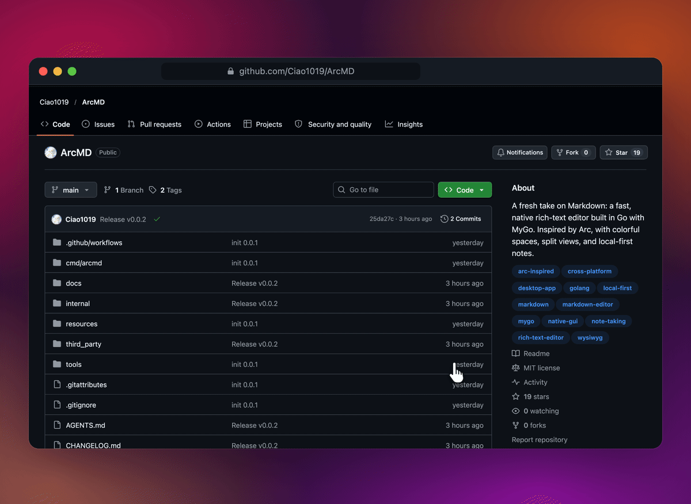

<div align="center">


**A fresh take on the Markdown editor — pure native 120 Hz performance, tactile motion, and spaces built around your life.**

[简体中文](README.md) · English

<a href="mygo.json"></a>

<a href="https://github.com/egoist/mygo"></a>
<a href=".github/workflows/build.yml"></a>
<a href="LICENSE"></a>

[](https://awesomemygo.dev/apps/arcmd)

<a href="https://trendshift.io/repositories/347199?utm_source=trendshift-badge&amp;utm_medium=badge&amp;utm_campaign=badge-trendshift-347199" target="_blank" rel="noopener noreferrer"></a>
<a href="https://hellogithub.com/repository/Ciao1019/ArcMD" target="_blank"></a>

<br>



<br><br>

<a href="https://github.com/Ciao1019/ArcMD/releases"></a>
<a href="https://github.com/Ciao1019/ArcMD/releases"></a>
<a href="https://github.com/Ciao1019/ArcMD/releases"></a>

<sub>The current version is 0.5.0. The buttons open the releases page, or you can <a href="#build-from-source">build from source</a>.</sub>

<br><br>

[Writing Flow](#writing-in-flow) · [Spaces & Reading](#spaces--reading-highlights) · [Native Markdown](#native-markdown-yours-forever) · [Features](#features-at-a-glance) · [Shortcuts](#essential-shortcuts) · [Performance](#performance) · [Build from source](#build-from-source) · [Contributing](#contributing) · [Roadmap](https://github.com/Ciao1019/ArcMD/issues/80)

</div>

<br>

ArcMD brings Markdown's familiar writing flow onto a calm, expressive native canvas.
**Built entirely in Go with [MyGo](https://github.com/egoist/mygo)'s Native UI** — windows, GPU drawing, glyph shaping, and input handling run directly from Go with **no HTML, JavaScript, WebView, Electron, or cgo**.

| ⚡ Pure Native, 120 Hz Ready | 📄 Plain `.md`, Zero Lock-in | 🎨 Arc Spaces & Tactile Craft |
| --- | --- | --- |
| Custom document engine and incremental layout keep typing at **0.248 ms P50** even in 1M-character documents, with non-blocking background saves. | Edits and autosaves standard `.md` files in place — no sidecar copies — so Obsidian, VS Code, Typora, and Git work on the exact same folder. | Multi-color Spaces, global Favorites, persistent Pinned tabs, a gliding caret, live syntax/TeX compilation, and spring micro-interactions. |

> **Tribute & Origin**
>
> The day The Browser Company announced Arc was entering maintenance mode, countless voices on X mourned the twilight of software crafted with so much taste, tactile delight, and soul. As a longtime devotee of Arc, I couldn't bear to let go of the vertical sidebar, vibrant Spaces, effortless Favorites, and that calm, breathing canvas. Since Arc paused its journey, we chose to carry its spirit forward into document editing with pure Go and Native UI — dedicated to every creator who still believes software should have craft, feel, and soul.

---

## Writing in Flow

Stay on one calm page instead of splitting your focus between raw source and preview — every keystroke, expansion, and drag you see in the hero animation above runs live on the same surface:

| 🪄 Live Syntax & Instant Rollback | ∑ Floating Inline & Display TeX |
| --- | --- |
| `**bold**`, `*italic*`, `~~strike~~`, `` `code` ``, `--`, and `...` compile in place as you type; auto-paired brackets, smart quotes, and `$…$` math show a soft scope tint and a <kbd>Tab</kbd> jump-out badge, while pressing <kbd>⌫</kbd> right away restores literal text. | Embedded KaTeX fonts render TeX natively; inline `$…$` floats a live source capsule below the line without shifting your baseline, and display math opens a unified preview + source card (<kbd>Tab</kbd> or `↵↵` continues prose). |
| **📐 Fluid Motion & Magnetic Snap** | **🖼️ Spring Physics & Zero-Shift Media** |
| Type `\| Header \|` + <kbd>Enter</kbd> to unfold a native table while folded sections, inserted blocks, and reordered rows glide smoothly out of the way; resizing table columns, two-column seams, or split panes snaps magnetically at `50% · 50%`. | A smoothly gliding caret, rounded selection capsules, and springy checkboxes keep editing tactile; drag in an image to watch a tilted Polaroid card settle upright with zero-shift header sizing and a damped hero lightbox on double-click. |

---

## Spaces & Reading Highlights

### Spaces & live themes: colors, gradients, translucency, and dark paper

<p align="center"></p>

Each space maps to a local folder with its own name, icon, persistent Pinned tabs, and last-open page. Swipe with two fingers on the sidebar or press <kbd>⌃1</kbd>…<kbd>⌃9</kbd> to glide into the next space, while global Favorites at the top open right in place without switching spaces. Open **Edit Theme Colors…** to blend one to three gradient stops, dial in frosted translucency and subtle grain, or flip between Light and Feishu-inspired Dark paper (`#1F2023`) with balanced color remapping.

### The Library: every space at a glance

<p align="center"></p>

Click the Library icon in the bottom-left corner or press <kbd>⇧⌘L</kbd>. The sidebar widens into a row of space cards painted in each space's own theme colors, with folders and pages ready to jump straight into. Plugins and the 30-day Recently Deleted collection live here too.

### A sidebar that steps aside — and peeks on demand

<p align="center"></p>

Press <kbd>⌘&#92;</kbd> (or narrow the window) and your page fills the entire window. Whenever you need another file, move the pointer to the left edge: the frosted floating sidebar glides out over your page, shows live miniature page thumbnails on hover, and tucks itself away the moment you return to writing.

### Hand-drawn marks: give your ideas a human touch

<p align="center"></p>

Select a phrase and pick from **12 hand-drawn stroke styles** and palette colors in the floating toolbar — circle what matters, cross out hesitation, or point an arrow at the next step. Every stroke draws itself in smoothly and round-trips losslessly in `.md` (and legacy `.arcmd`) files. Try the [idea journal sample](docs/images/readme/annotations-demo-en.arcmd), or start with a line of your own.

### Margin bookmarks: pick up right where you left off

<p align="center"></p>

Hover any block to reveal a margin bookmark, or press <kbd>⌘D</kbd>. Your marks appear automatically in the document outline (with rendered TeX previews for math blocks), <kbd>⌃⌘↑</kbd> / <kbd>⌃⌘↓</kbd> hop smoothly between them, and <kbd>⇧⌘D</kbd> searches bookmarks across every space — without ever modifying the `.md` file itself.

---

## Native Markdown, Yours Forever

ArcMD edits and autosaves standard **`.md` Markdown** files (`.md`, `.markdown`, `.mdx`) directly in place in the background — **no proprietary database and no sidecar `.arcmd` duplicates**. Every note is a plain local file with its images in a nearby `assets/` folder, ready for Obsidian, Typora, VS Code, or Git.

- **Untouched blocks stay untouched**: block-level source diffing (`ImportSource`) preserves your original indentation, list markers, and link syntax on paragraphs you didn't edit.
- **100% lossless rich round-trips**: text colors, highlights, hand-drawn marks, five-tone callouts (GitHub `> [!NOTE]` alerts), `<details>` toggles, merged/colored tables, custom-width two-column layouts (`data-widths`), and page icons/covers/word goals degrade cleanly via standard Markdown + semantic HTML + YAML frontmatter and restore completely in ArcMD.
- **Backward compatible**: existing legacy `.arcmd` files and history snapshots continue to open and edit seamlessly.

---

## Features at a Glance

| Area | Built-in Capabilities |
| --- | --- |
| **Expressive Blocks** | H1–H6 headings, nested lists & tasks, quotes, five-tone icon callouts, stateful incremental syntax highlighting across 17 languages (with per-block soft-wrap toggle), native Mermaid flowcharts & zoomable sequence diagrams, Excalidraw-compatible hand-drawn whiteboards (`.excalidraw.svg` / `.excalidraw` & `/` inline boards), `\boldsymbol` & `\tag` math formulas, native 3D `<kbd>` keycaps & inline/block HTML, `<details>` toggles, footnotes, superscript/subscript, `:sm` emoji search, `@` dates & page mentions, optional CJK–Latin auto-spacing. |
| **Tables, Columns & Media** | CSV/TSV paste-to-table, row/column drag reorder, cell merge/split, 16 cell fills, natural column sort; adjustable two-column layouts; per-Space attachments folder with automatic relinking, non-destructive image crop (keeping originals) & inline GIF playback; multi-block marquee selection & outline section drag. |
| **Splits, Command Bar & Templates** | Up to four side-by-side split panes or dedicated native windows; sidebar multi-select & batch move/folder creation; zero-blocking <kbd>⌘K</kbd> command bar (Pinyin/initials & multi-keyword full-text search with persistent disk cache, undoable <kbd>⇧⌘R</kbd> cross-document replace); Space templates (`{{date}}`, `{{time}}`, `{{weekday}}`, `{{title}}`) & <kbd>⌥⌘T</kbd> Daily Notes. |
| **Mind Map, Links & Safety** | <kbd>⌃⌘M</kbd> navigable document mind map; `[[Wiki links]]` autocomplete across spaces, backlinks footer & rename sync, workspace `#tags`; <kbd>⇧⌘F</kbd> Focus Mode, paragraph afterglow dimming, typewriter scroll, word goals & per-pane reading lock; <kbd>⇧⌘M</kbd> synced Markdown preview, pure-Go vector PDF (Type 3 outlines, bookmarks & clickable links) & standalone HTML export; `.arcmd/history` named milestones, Git diff view & IDEA-style 3-Way Merge conflict resolution. |
| **Amphibious Databases** | Native `.db.md` local-first database engine (each record is a plain `.md` file with lossless YAML frontmatter sync and an embedded GFM snapshot); **9 native views** (Table, Board, Calendar with Day/Week/Month/Year/Agenda, Timeline/Gantt, List, Gallery, Chart, Feed, and Form), 18 property types (including bidirectional Relation, Rollup, and Formula 2.0), conditional coloring, CSV / Notion import, inline Linked View blocks, and 120 Hz spring drag-and-drop motion. |
| **Space Q&A & Cloud Sync** | Press <kbd>⌘J</kbd> for a zero-index Space research panel streaming cited answers with inline monogram chips, gliding source previews, OpenAI / DeepSeek / OpenRouter / local Ollama presets, streaming Chat Completions & Responses protocol selection, and `arcmd ask -protocol` / `ARCMD_AI_PROTOCOL`; built-in `arcmd mcp` and CLI control for local coding agents; pure-Go `wazero` WASM plugin sandbox with on-demand marketplace plugins including **Cloud Sync** (S3 / R2 / OSS / COS / MinIO & WebDAV 3-way incremental sync) and **Image Host**. |

**Small core, extensible by design**: ArcMD builds in a read-only Space Q&A agent, local CLI/MCP agent control, and a pure-Go `wazero` WASM plugin sandbox (with permission prompts, isolated secrets, verified marketplace downloads, and local `.zip` install), while official plugins live in [`Ciao1019/arcmd-plugins`](https://github.com/Ciao1019/arcmd-plugins) for on-demand installation so the core editor stays fast and lean. See the [plugin specification](docs/plugins.md).

---

## Essential Shortcuts

Every action is reachable from the <kbd>⌘K</kbd> command bar, and shortcuts can be customized in **Settings → Shortcuts** (use <kbd>Ctrl</kbd> in place of <kbd>⌘</kbd> on Windows and Linux):

| Shortcut | Action | Shortcut | Action |
| --- | --- | --- | --- |
| <kbd>⌘K</kbd> / <kbd>⌘P</kbd> | Command bar & full-text search | <kbd>⌃1</kbd>…<kbd>⌃9</kbd> | Switch to Space 1–9 |
| <kbd>⌘N</kbd> / <kbd>⇧⌘N</kbd> / <kbd>⌥⌘B</kbd> / <kbd>⌥⌘G</kbd> | New document / folder / whiteboard / database | <kbd>⇧⌘L</kbd> | Open Library (Spaces / Plugins / Trash) |
| <kbd>⌘&#92;</kbd> | Collapse / expand sidebar | <kbd>⌃⇧=</kbd> / <kbd>⌃⇧−</kbd> | Add / close split pane |
| <kbd>⇧⌘M</kbd> | Rich text ⇄ Markdown preview (synced) | <kbd>⇧⌘F</kbd> | Toggle Focus Mode |
| <kbd>⌘F</kbd> / <kbd>⇧⌘R</kbd> | Find & replace / Replace across space | <kbd>⌘D</kbd> / <kbd>⇧⌘D</kbd> | Toggle bookmark / All bookmarks |
| <kbd>⌥⌘T</kbd> | Open or create Today's Note | <kbd>⌥⌘Y</kbd> | Version history & diff restore |
| <kbd>⌘=</kbd> / <kbd>⌘−</kbd> / <kbd>⌘0</kbd> | Zoom in / out / reset to 100% | <kbd>⇧⌘&#92;</kbd> | Clear inline formatting & links |
| <kbd>⌘J</kbd> | Ask current Space (Space Q&A) | <kbd>⇧⌘E</kbd> | Export vector PDF with outlines & links |

---

## Performance

CPU frame construction time across **100 consecutive operations** in a mixed document of **1 million characters, 549 chapters, 500 tables, and 9,912 table cells** (median of P50 and P95 across three fresh processes):

| Operation | P50 | P95 |
| --- | ---: | ---: |
| ⌨️ Typing | **0.248 ms** | **0.304 ms** |
| ⌫ Backspace | **0.245 ms** | **0.284 ms** |
| 🖱️ Scrolling | **0.447 ms** | **1.059 ms** |

A 120 Hz display budgets **8.3 ms** per frame. Even on a million-character document, CPU scene construction stays under **1.1 ms at P95**. Including event handling, body typing measures **0.249 ms P50**, typing with Find open **0.260 ms**, repeated IME candidate updates **0.234 ms**, and ordinary typing allocates **0.063 MB/op** (allocation volume, not resident memory).

<details>
<summary>Environment & benchmark notes</summary>

- **Setup**: Apple M5 / 24 GiB, macOS 26.5.1, Go 1.27.3, MyGo v0.10.0, `CGO_ENABLED=0`.
- **Scope**: Measures CPU scene construction through a headless host running the normal frame pipeline; excludes OS input dispatch, GPU rasterization/presentation, and display latency.
- **Reproduce**: [Performance report](docs/performance.md) · [Benchmark harness](tools/perf/README.md).

</details>

---

## Get ArcMD & Build from Source

Download prebuilt packages from [GitHub Releases](https://github.com/Ciao1019/ArcMD/releases) ([packaging workflow](.github/workflows/build.yml)):

| Platform | Architectures | Packages |
| --- | --- | --- |
| macOS | Apple Silicon, Intel | `.dmg` (currently ad-hoc signed, not notarized) |
| Windows | x64 | Installer `.exe`, portable `.zip` (currently unsigned) |
| Linux | x64 | `.deb`, `.tar.gz`, Arch Linux `.pkg.tar.zst` |
| Linux | ARM64 | `.deb`, `.tar.gz` |

### Build from source

Requires **Go 1.27.3** or newer (`GOTOOLCHAIN=auto` downloads the matching toolchain automatically):

```sh
git clone https://github.com/Ciao1019/ArcMD.git
cd ArcMD
CGO_ENABLED=0 go run ./cmd/arcmd
```

Run with an isolated development directory:

```sh
ARCMD_HOME=/tmp/arcmd-dev CGO_ENABLED=0 go run ./cmd/arcmd
```

Build a native application bundle (see [Building and releasing](docs/building.md)):

```sh
CGO_ENABLED=0 go run github.com/egoist/mygo/cmd/mygo@v0.10.0 build
```

---

## Contributing

Explore upcoming plans and vote on priorities in the [Roadmap (#80)](https://github.com/Ciao1019/ArcMD/issues/80). Bug reports, ideas, and pull requests are welcome via [GitHub Issues](https://github.com/Ciao1019/ArcMD/issues). Start with the [architecture guide](docs/architecture.md) and [contributor conventions](AGENTS.md).

Before submitting changes, run:

```sh
gofmt -l .
CGO_ENABLED=0 go vet ./...
CGO_ENABLED=0 go test ./...
CGO_ENABLED=0 GOOS=linux go build ./...
CGO_ENABLED=0 GOOS=windows go build ./...
```

For UI changes, render and inspect headless native snapshots:

```sh
ARCMD_SNAPSHOT=/tmp/arcmd-shots CGO_ENABLED=0 go test -run Snapshot ./internal/app
```

<div align="center">

If ArcMD is useful to you, a **⭐ Star** in the top-right corner means a lot!

<a href="https://github.com/Ciao1019/ArcMD/stargazers"></a>

</div>

## Star History

<div align="center">

<a href="https://www.star-history.com/?repos=ciao1019%2Farcmd&type=date&legend=top-left">
 <picture>
   <source media="(prefers-color-scheme: dark)" srcset="https://api.star-history.com/chart?repos=ciao1019/arcmd&type=date&theme=dark&legend=top-left" />
   <source media="(prefers-color-scheme: light)" srcset="https://api.star-history.com/chart?repos=ciao1019/arcmd&type=date&legend=top-left" />
   
 </picture>
</a>

</div>

## Acknowledgements

Thanks to the [LinuxDo](https://linux.do/) community for its support.

## License

ArcMD is open source under the [MIT License](LICENSE). Third-party notices and licenses are preserved in [third_party](third_party/).
