<div align="center">


**重新想象 Markdown 编辑器：纯 Go 原生满帧、行云流水的触感，让每个想法都有自己的空间。**

简体中文 · [English](README.en.md)

<a href="mygo.json"></a>

<a href="https://github.com/egoist/mygo"></a>
<a href=".github/workflows/build.yml"></a>
<a href="LICENSE"></a>


[](https://awesomemygo.dev/apps/arcmd)

<br>


<br><br>

<a href="https://github.com/Ciao1019/ArcMD/releases"></a>
<a href="https://github.com/Ciao1019/ArcMD/releases"></a>
<a href="https://github.com/Ciao1019/ArcMD/releases"></a>

<sub>当前预览版本为 0.4.0，按钮会打开发布页；也可以直接<a href="#从源码运行">从源码运行</a>。</sub>

<br><br>

[书写交互](#行云流水的书写交互) · [空间与阅读](#空间与阅读亮点) · [原生 Markdown](#原生-markdown不绑架你的文件) · [功能全景](#功能全景) · [常用快捷键](#常用快捷键) · [性能](#性能) · [从源码运行](#从源码运行) · [参与贡献](#参与贡献)

</div>

<br>

ArcMD 将熟悉的 Markdown 写作流带入细腻跟手的原生富文本画布。
完全使用 **Go** 与 **[MyGo](https://github.com/egoist/mygo) Native UI** 自研开发——由 Go 直接驱动窗口绘制、字形排版与系统输入，**零 HTML、JavaScript、WebView、Electron 或 cgo**。

| ⚡ 纯粹原生，120 Hz 满帧 | 📄 原生 `.md`，来去自由 | 🎨 Arc 式空间与微交互 |
| --- | --- | --- |
| 自研结构化文档引擎与增量排版，百万字混合长文输入 P50 仅 **0.248 ms**，后台落盘主线程零卡顿。 | 直接原地读写标准 `.md` 文件，不制造私有副本，随时与 Obsidian、VS Code、Typora 和 Git 共用同一文件夹。 | 多彩 Space 轻扫切换、全局收藏、置顶常驻标签页，配合光标滑行、即时语法编译与弹簧微动效。 |

> **致敬与起源**
>
> The Browser Company 宣布 Arc 步入维护模式的那天，X 上无数人都在惋惜一款如此充满审美、手感与灵魂的软件走向终局。作为一个 Arc 的长期拥趸，我不舍得那些彻底改变了我工作流的竖向侧栏、多色彩 Space、全局收藏以及安静克制的呼吸感。既然 Arc 停下了脚步，那我们就用纯 Go 与原生 UI，在文档编辑的世界里把它延续下去——献给每一个依然相信「软件应该有审美与触感」的创作者。

> [!NOTE]
> **ArcMD 仍处于早期预览阶段**，不少细节仍在持续打磨迭代。如果你也喜欢这个方向，欢迎在 [Issues](https://github.com/Ciao1019/ArcMD/issues) 分享反馈与想法，或直接提交 Pull Request 一起构建。

---

## 行云流水的书写交互

不用在「源码」与「预览」两栏之间分心切换——你在首屏动图中看到的每一次落笔、展开与拖拽，都运行在同一张安静连贯的纸面上：

| 🪄 即时成形与反悔自由 | ∑ 行内与块级公式浮窗 |
| --- | --- |
| 输入 `**粗体**`、`*斜体*`、`~~删除线~~`、`` `代码` ``、`--` 与 `...` 即刻原地成形；括号、弯引号与 `$…$` 自动配对并浮现柔和范围染色与 <kbd>Tab</kbd> 跳出徽章，紧接按一次 <kbd>⌫</kbd> 随时退回字面原文。 | 内嵌 KaTeX 字体原生排版 TeX 公式；行内 `$…$` 在正下方浮出实时源码胶囊而不挤动行高与基线，块级公式展开「上方实时预览 + 下方源码」一体化卡片，按 <kbd>Tab</kbd> 或连按两次回车即可接续正文。 |
| **📐 顺滑让位与磁吸对齐** | **🖼️ 弹簧触感与零跳动媒体** |
| 敲下 `\| 表头 \|` 回车直接展开原生表格，折叠章节、增删块与拖拽换位的表格行列都会指数阻尼顺滑让位；拖动表格列宽、双栏中缝或分屏分隔条靠近等分时自动浮现 `50% · 50%` 磁吸胶囊。 | 光标跨字跨行平滑滑行，圆角胶囊选区贴合字句，任务框轻弹勾选；从访达拖入图片浮现微倾拍立得预览卡并轻弹落位，图片头部瞬时定尺寸（零布局跳动）并支持双击原位阻尼缩放灯箱。 |

---

## 空间与阅读亮点

### 专属空间与实时配色：颜色、渐变、通透与深浅纸面

<p align="center"></p>

每个空间对应一个本地文件夹，拥有独立的名称、图标、置顶常驻文档与阅读现场。在侧边栏双指轻扫或按 <kbd>⌃1</kbd>…<kbd>⌃9</kbd> 即可滑入下一个空间；顶部的全局收藏跨越所有空间，点一下就在当前空间原地打开。打开「••• › 编辑主题颜色…」，可自由组合 1–3 色渐变、调节通透光影与颗粒感，或在浅色白纸与飞书风格深色纸面（`#1F2023`，自动重映射全部文字与高亮色调）之间平滑切换。

### 资料库：所有空间，一眼尽览

<p align="center"></p>

点击左下角的资料库图标或按 <kbd>⇧⌘L</kbd>，侧边栏会平滑展开成一排空间卡片，每张卡片都以各自空间的主题色绘制，文件夹与文档随手可点开跳转。插件管理与保留 30 天的「最近删除」也集中在这里。

### 专注时让开，需要时浮现

<p align="center"></p>

按 <kbd>⌘&#92;</kbd> 收起侧边栏（窄窗口下也会自动收起），让页面安静铺满整个窗口。需要切换文档时无需重新展开：把指针移到窗口左缘，毛玻璃浮动侧边栏便轻巧滑出；悬停任意文档或文件夹即可查看实时纸面缩略图预览，移回正文即自动收回。

### 手绘标注：让重点，有一点温度

<p align="center"></p>

选中文字后点开浮动工具栏的标注面板，从 **12 种手绘笔触**与可选色彩中挑一种语气——圈出关键决定、划掉犹豫、给下一步画一枚箭头。每一笔都会逐笔自然绘出，并无损保存在 `.md`（及旧版 `.arcmd`）文档中。试试这篇[灵感手记示例](docs/images/readme/annotations-demo-zh-CN.arcmd)，或从自己的第一句开始。

### 页边书签：读到哪儿，回到哪儿

<p align="center"></p>

指针移到任意段落旁，页边即淡显书签图标，点一下或按 <kbd>⌘D</kbd> 即可标记。文档目录会同步列出书签（公式块自动渲染为公式缩略图），<kbd>⌃⌘↑</kbd> / <kbd>⌃⌘↓</kbd> 在书签间平滑跳转，<kbd>⇧⌘D</kbd> 在命令栏检索所有空间的书签；书签独立存储，绝不弄脏 `.md` 原文。

---

## 原生 Markdown，不绑架你的文件

ArcMD 直接以标准 **`.md` Markdown** 作为主格式，编辑时在后台原地自动保存到原文件（`.md` / `.markdown` / `.mdx`），**不会在旁边生成额外的 `.arcmd` 副本**。每篇文档都是普通的本地纯文本文件，图片存放在同级 `assets/` 目录中，可随时与 Obsidian、Typora、VS Code 或 Git 无缝混用。

- **未改动段落原样保留**：通过分块比对原始 Markdown（`ImportSource`），未编辑的段落不会改写你原有的缩进、列表符号或链接写法。
- **扩展排版 100% 无损往返**：文字颜色、背景高亮、手绘标注、五色高亮块（GitHub Alert `> [!NOTE]` 等）、折叠块（`<details>`）、跨格合并与着色表格、自定义比例双栏（`data-widths`）以及页面图标、封面与字数目标，通过标准 Markdown + 语义化 HTML + YAML Frontmatter 在其他阅读器中优雅降级、回到 ArcMD 完整还原。
- **平滑向下兼容**：已有的旧版 `.arcmd` 文档与历史快照仍可直接打开、编辑与迁移。

---

## 功能全景

| 领域 | 内置能力 |
| --- | --- |
| **丰富内容块** | H1–H6 标题、嵌套列表与任务、引用、五色可换图标高亮块、17 种语言状态机增量高亮代码块（支持单块自动换行切换）、原生 Mermaid 流程图与可无损缩放时序图、Excalidraw 兼容手绘白板（`.excalidraw.svg` / `.excalidraw` 与 `/` 内嵌白板）、`\boldsymbol` 与 `\tag` 数学公式、原生 `<kbd>` 3D 键帽与常见行内/块级 HTML、`<details>` 折叠块、脚注、上下标、`:sm` 表情与 `@` 日期/文档提及、可选中英文自动加空格。 |
| **表格、双栏与媒体** | CSV/TSV 粘贴建表、行列拖拽换位、跨格合并拆分、16 色底色、按列自然排序；可调比例双栏布局；空间自定义附件目录与移动自动重链、图片无损裁剪（保留原图）与页面内 GIF 播放；框选多块批量操作与目录拖拽移动整章。 |
| **分屏、命令栏与模板** | 最多四分屏并排或拆分为独立原生窗口；侧边栏多选与批量移动/建夹；零阻塞 <kbd>⌘K</kbd> 命令栏（拼音/首字母与多关键词全文检索、持久化磁盘缓存、<kbd>⇧⌘R</kbd> 跨文档替换与一键撤销）；空间模板（`{{date}}` / `{{time}}` / `{{weekday}}` / `{{title}}`）与 <kbd>⌥⌘T</kbd> 今日笔记。 |
| **导图、双链与守护** | <kbd>⌃⌘M</kbd> 原生可导航文档思维导图；`[[双链]]` 跨空间补全、反向链接聚合与改名自动同步，`#标签` 全局整理；<kbd>⇧⌘F</kbd> 专注模式、段落余晖淡化、打字机滚动、字数目标与分屏只读锁；<kbd>⇧⌘M</kbd> 同步位置 Markdown 预览、纯 Go 矢量 PDF（Type 3 字形、目录书签与可点击链接） / 独立 HTML 导出；`.arcmd/history` 命名里程碑、Git 差异视图与 IDEA 式三栏合并恢复。 |
| **两栖多维数据库** | 原生 `.db.md` 两栖多维表格引擎（每条记录即本地 `.md` + Frontmatter 双向同步，自带离线 GFM 表格快照）；支持表格、看板、日历（日/周/月/年/日程）、甘特时间轴、列表、画廊、图表、动态流与表单 **9 种视图**、18 种属性（含跨库双向 Relation / Rollup / Formula 2.0）、条件着色、CSV / Notion 导入、文档内嵌 Linked View 与 120 Hz 弹簧微动效。 |
| **空间问答与云端同步** | <kbd>⌘J</kbd> 打开只读空间问答面板（零向量库，流式内联引用胶囊、滑移预览与直达块定位，支持 OpenAI / DeepSeek / OpenRouter / 本地 Ollama、流式 Chat Completions 与 Responses 协议切换及终端 `arcmd ask -protocol` / `ARCMD_AI_PROTOCOL`）；支持 `arcmd mcp` 与 CLI 让本地 Agent 协同读写空间、白板与数据库；纯 Go `wazero` WASM 插件沙箱，支持从插件市场按需安装官方「云端同步」（S3 / R2 / OSS / COS / MinIO 与 WebDAV 三路增量同步）与「图床上传」插件。 |

**轻量核心，按需扩展**：核心内置只读的空间问答 Agent、本地 Agent CLI/MCP 控制接口与纯 Go `wazero` WASM 插件沙箱（支持权限确认、凭据隔离、远程市场 SHA-256 校验安装与本地 `.zip` 安装），官方插件独立托管于 [`Ciao1019/arcmd-plugins`](https://github.com/Ciao1019/arcmd-plugins) 按需下载，让编辑器核心始终纯粹轻快。详见[插件规范（英文）](docs/plugins.md)。

---

## 常用快捷键

所有操作均可通过 <kbd>⌘K</kbd> 命令栏触达，常用快捷键可在「设置 › 快捷键」中重新录制（Windows / Linux 下将 <kbd>⌘</kbd> 替换为 <kbd>Ctrl</kbd>）：

| 快捷键 | 功能 | 快捷键 | 功能 |
| --- | --- | --- | --- |
| <kbd>⌘K</kbd> / <kbd>⌘P</kbd> | 打开命令栏与全文搜索 | <kbd>⌃1</kbd>…<kbd>⌃9</kbd> | 切换到第 N 个空间 |
| <kbd>⌘N</kbd> / <kbd>⇧⌘N</kbd> / <kbd>⌥⌘B</kbd> / <kbd>⌥⌘G</kbd> | 新建文档 / 文件夹 / 白板 / 数据库 | <kbd>⇧⌘L</kbd> | 打开资料库（空间 / 插件 / 最近删除） |
| <kbd>⌘&#92;</kbd> | 收起 / 展开侧边栏 | <kbd>⌃⇧=</kbd> / <kbd>⌃⇧−</kbd> | 添加 / 关闭分屏面板 |
| <kbd>⇧⌘M</kbd> | 富文本 ⇄ Markdown 预览（同步位置） | <kbd>⇧⌘F</kbd> | 进入 / 退出专注模式 |
| <kbd>⌘F</kbd> / <kbd>⇧⌘R</kbd> | 页内查找替换 / 跨文档查找替换 | <kbd>⌘D</kbd> / <kbd>⇧⌘D</kbd> | 添加移除书签 / 全部书签列表 |
| <kbd>⌥⌘T</kbd> | 打开或创建今日笔记 | <kbd>⌥⌘Y</kbd> | 查看版本历史与差异恢复 |
| <kbd>⌘=</kbd> / <kbd>⌘−</kbd> / <kbd>⌘0</kbd> | 放大 / 缩小页面 / 重置为 100% | <kbd>⇧⌘&#92;</kbd> | 一键清除选中文本样式与链接 |
| <kbd>⌘J</kbd> | 向当前空间提问（空间问答） | <kbd>⇧⌘E</kbd> | 导出矢量 PDF（含书签与链接） |

---

## 性能

在包含 **100 万字符、549 个章节、500 张表格与 9,912 个单元格**的混合文档中，连续执行 **100 次**输入、退格与滚动操作，在三个独立新进程中测量 CPU 单帧场景构建耗时（取中位数）：

| 操作 | P50 | P95 |
| --- | ---: | ---: |
| ⌨️ 输入 | **0.248 ms** | **0.304 ms** |
| ⌫ 退格 | **0.245 ms** | **0.284 ms** |
| 🖱️ 滚动 | **0.447 ms** | **1.059 ms** |

120 Hz 显示器的每帧预算约为 **8.3 ms**。即使面对百万字长文，CPU 场景构建的 P95 仍低于 **1.1 ms**；包含事件处理的正文输入 P50 为 **0.249 ms**，打开查找框输入为 **0.260 ms**，输入法连续候选更新为 **0.234 ms**，单次普通输入分配量约 **0.063 MB/次**（分配吞吐，非常驻内存）。

<details>
<summary>测试环境与测量说明</summary>

- **硬件与环境**：Apple M5 / 24 GiB，macOS 26.5.1，Go 1.27.3，MyGo v0.10.0，`CGO_ENABLED=0`。
- **统计口径**：通过无窗口宿主运行完整帧构建管线，测量 CPU 场景构建耗时；不包含系统事件分发、GPU 光栅化呈现与显示器延迟，因此不直接等同于端到端屏幕延迟。
- **复现方法**：详见[性能报告（英文）](docs/performance.md)与[基准测试工具（英文）](tools/perf/README.md)。

</details>

---

## 获取与从源码运行

可在 [GitHub Releases](https://github.com/Ciao1019/ArcMD/releases) 下载各平台预编译包（[CI 打包工作流](.github/workflows/build.yml)）：

| 平台 | 架构 | 安装包 |
| --- | --- | --- |
| macOS | Apple Silicon、Intel | `.dmg`（当前为临时 ad-hoc 签名，尚未公证） |
| Windows | x64 | `.exe` 安装程序、`.zip` 便携包（尚未代码签名） |
| Linux | x64 | `.deb`、`.tar.gz`、Arch Linux `.pkg.tar.zst` |
| Linux | ARM64 | `.deb`、`.tar.gz` |

### 从源码运行

需要 **Go 1.27.3** 或更高版本（开启 `GOTOOLCHAIN=auto` 时会自动下载对应工具链）：

```sh
git clone https://github.com/Ciao1019/ArcMD.git
cd ArcMD
CGO_ENABLED=0 go run ./cmd/arcmd
```

使用隔离的开发目录体验（不影响个人文稿与配置）：

```sh
ARCMD_HOME=/tmp/arcmd-dev CGO_ENABLED=0 go run ./cmd/arcmd
```

构建原生应用安装包（详见[构建与发布指南](docs/building.md)）：

```sh
CGO_ENABLED=0 go run github.com/egoist/mygo/cmd/mygo@v0.10.0 build
```

---

## 参与贡献

欢迎通过 [GitHub Issues](https://github.com/Ciao1019/ArcMD/issues) 提交问题与建议，或直接发起 Pull Request。动手前请先阅读[架构说明（英文）](docs/architecture.md)与[贡献约定](AGENTS.md)。

提交改动前请确保以下检查通过：

```sh
gofmt -l .
CGO_ENABLED=0 go vet ./...
CGO_ENABLED=0 go test ./...
CGO_ENABLED=0 GOOS=linux go build ./...
CGO_ENABLED=0 GOOS=windows go build ./...
```

若修改了界面，请运行无窗口快照测试并目检渲染结果：

```sh
ARCMD_SNAPSHOT=/tmp/arcmd-shots CGO_ENABLED=0 go test -run Snapshot ./internal/app
```

## Star History

<a href="https://www.star-history.com/?repos=ciao1019%2Farcmd&type=timeline&legend=top-left">
 <picture>
   <source media="(prefers-color-scheme: dark)" srcset="https://api.star-history.com/chart?repos=ciao1019/arcmd&type=date&theme=dark&legend=top-left" />
   <source media="(prefers-color-scheme: light)" srcset="https://api.star-history.com/chart?repos=ciao1019/arcmd&type=date&legend=top-left" />
   
 </picture>
</a>


## 致谢

感谢 [LinuxDo](https://linux.do/) 社区的支持。

## 许可证

ArcMD 基于 [MIT License](LICENSE) 开源。第三方字体、算法参考与许可证声明完整保留于 [third_party](third_party/) 目录。
