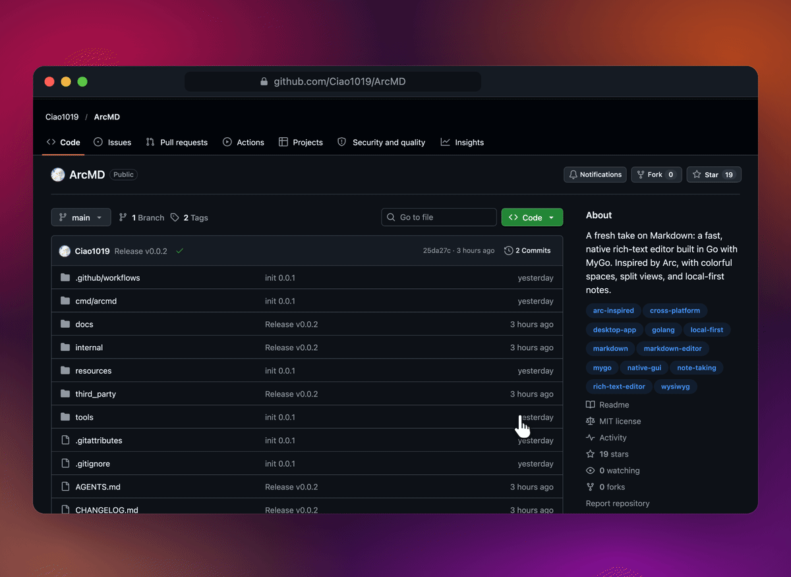

<div align="center">


**重新想象 Markdown 编辑器：原生体验、丰富表达，让每个想法都有自己的空间。**

简体中文 · [English](README.en.md)

<a href="mygo.json"></a>

<a href="https://github.com/egoist/mygo"></a>
<a href=".github/workflows/build.yml"></a>
<a href="LICENSE"></a>


[](https://awesomemygo.dev/apps/arcmd)

<br><br>


<br><br>

<a href="https://github.com/Ciao1019/ArcMD/releases"></a>
<a href="https://github.com/Ciao1019/ArcMD/releases"></a>
<a href="https://github.com/Ciao1019/ArcMD/releases"></a>

<sub>当前预览版本为 0.0.11，按钮会打开发布页；也可以<a href="#从源码运行">从源码运行</a>。</sub>

<br><br>

[亮点](#亮点) · [功能介绍](#功能介绍) · [性能](#性能) · [从源码运行](#从源码运行) · [参与贡献](#参与贡献)

</div>

<br>

> **致敬与起源**
>
> The Browser Company 宣布 Arc 步入维护模式的那天，X 上无数人都在惋惜一款如此充满审美、手感与灵魂的软件走向终局。
>
> 作为一个 Arc 的长期忠实拥趸，我不舍得那些彻底改变了我工作流的竖向侧栏、多色彩 Space、全局收藏以及安静克制的呼吸感。既然 Arc 停下了脚步，那我们就用纯 Go 与原生 UI，在文档编辑的世界里把它延续下去——没有 Electron、没有 Webview，只有纯粹的原生性能与纯粹的 Arc 交互体验。
>
> ArcMD，献给每一个依然相信「软件应该有审美与触感」的创作者。

ArcMD 是一款将 Markdown 写作习惯与富文本编辑结合的新概念文档编辑器。
设计灵感来自 [Arc](https://arc.net/)：竖向侧边栏、多彩空间、全局收藏，以及让文字成为主角的安静页面。
无论是记录日常、整理灵感，还是管理整个项目，都可以在这里建立自己的写作空间。

**完全使用 Go 和 [MyGo](https://github.com/egoist/mygo) 的 Native UI 原生开发。**
MyGo 提供原生窗口、GPU 绘制、字形排版和系统输入接口，ArcMD 在此基础上构建自己的文档引擎与富文本编辑器。
整个界面直接由 Go 绘制，无需 HTML、JavaScript、WebView、Electron 或 cgo。

> [!NOTE]
> **ArcMD 还很年轻。** 项目目前处于早期预览阶段，很多地方还不完善，尤其是编辑器仍比较朴素，正在一点点打磨迭代。
> 如果你也喜欢这个方向，欢迎通过 [Issues](https://github.com/Ciao1019/ArcMD/issues) 反馈问题和想法，或者直接提交 Pull Request，一起把它做得更好。

## 亮点

### 生活的每个部分，都有一个空间

每个空间对应一个文件夹，拥有自己的名称、图标和主题色——一到三种颜色，再加一点颗粒质感。
在侧边栏上双指轻扫，或按 <kbd>⌃1</kbd>…<kbd>⌃9</kbd>，整个窗口就会滑入下一个空间。
每个空间都记得你上次停留的页面；收藏则跟着你走遍所有空间。

### 颜色、渐变、透明与颗粒，整个窗口实时预览

<p align="center"></p>

在空间名称的「•••」菜单里选择「编辑主题颜色…」，拖动色盘上的圆点换颜色，用 − / + 组合一到三种颜色的渐变。
单色主题降低强度后，窗口会变得半透明，透出背后柔和模糊的桌面；再拧一拧颗粒旋钮，或切换跟随系统、浅色、深色。

### 手绘标注：让重点，有一点温度

<p align="center"></p>

选中一段文字，点浮动工具条里标注按钮旁的下拉箭头，挑一种喜欢的笔触。
12 种手绘样式，圈出重要的事、划掉犹豫、给下一步画个箭头；线条会轻轻画出来，颜色也能随心调整。
标注随 `.arcmd` 文档保存。试试这篇[灵感手记](docs/images/readme/annotations-demo-zh-CN.arcmd)，或从自己的第一句开始。

### 书签：读到哪儿，回到哪儿

<p align="center"></p>

指针移到任意段落上，页边会出现书签图标，点一下（或按 <kbd>⌘D</kbd>）就标记好了。
目录底部列出本文档的书签，<kbd>⌃⌘↑</kbd> / <kbd>⌃⌘↓</kbd> 在书签间跳转，<kbd>⇧⌘D</kbd> 列出所有文档的书签；书签不会改动文档本身。

### 资料库：所有空间一览无余

<p align="center"></p>

点击左下角的资料库按钮，或按 <kbd>⇧⌘L</kbd>，侧边栏会展开成所有空间的卡片，每张都用各自的主题色绘制，文件夹随手可展开。
点开任意页面即可直接跳过去。插件与「最近删除」也都在这里。

### 需要时出现，不需要时让开

<p align="center"></p>

按 <kbd>⌘ &#92;</kbd>，页面铺满整个窗口。需要找文件时，把指针移到窗口左缘，侧边栏就会浮在页面上滑出；指针一离开，它又自动收回。
窗口较窄时，侧边栏会自动收起。

## 功能介绍

### 自然书写，丰富表达

- **富文本格式**：标题、粗体、斜体、下划线、删除线、链接、行内代码、文字颜色与高亮。
  选中文字即可使用浮动工具栏，输入 `/` 插入内容块。
- **手绘标注**：12 种笔触与可选颜色，用圈线、波浪线、荧光笔、箭头和方框表达重点，线条逐笔画出。
- **多种内容块**：嵌套列表、任务、引用、彩色高亮块、代码块、图片、行内与块级 TeX 公式、脚注、上下标、支持合并单元格的可编辑表格，以及双栏布局。
- **顺手的输入**：Markdown / HTML 剪贴板交换、括号引号配对、可选的中英文自动空格；输入 `:sm` 搜索表情，或用 `@` 插入日期与文档链接。
- **清晰的文档结构**：可导航的目录、可折叠的标题、列表与折叠块；多选内容块后统一移动、缩进、复制或删除。页面支持图标、图片封面与渐变封面。
- **表格与图片**：粘贴 CSV / 制表符文本生成表格，按列排序；图片可拖拽调尺寸、连续缩放和裁剪，裁剪保留原图，GIF 在页面中播放。
- **带上已有内容**：导入和导出 Markdown，从网页及文档应用粘贴富文本，也可以将页面导出为 PDF 或 HTML 网页。

### 每个项目，都有自己的空间

- **多空间**：为工作、生活和不同项目分别选择文件夹，设置独立的名称、图标和浅色或深色主题，通过触控板轻扫或快捷键切换。
- **收藏与置顶**：跨空间共享常用收藏，在每个空间内置顶文档或文件夹；拖动即可排序、整理和跨空间移动。
- **分屏与独立窗口**：同时打开最多四个分屏面板，也能将文档移入独立窗口；各自保留光标、滚动位置和撤销历史。
- **快速导航与整理**：命令栏记住最近使用的命令，支持全文搜索和跨文档替换；文件夹可按名称或修改时间排序，文档与文件夹都有悬停预览。
- **模板与今日笔记**：把常用文档保存成空间模板，用日期、时间、星期与标题占位符快速开始；一键打开或创建今日笔记。

### 连接想法，保持专注

- **双链与标签**：用 `[[双链]]` 连接文档，查看反向链接，通过 `#标签` 浏览内容并批量重命名或合并标签；重命名文档时自动更新指向它的链接。
- **书签**：指针移到段落上，点右侧出现的书签图标（或按 ⌘D）标记想回来看的段落，⌃⌘↑ / ⌃⌘↓ 在书签间跳转，目录与命令栏列出全部书签，可命名；书签不改动文档本身。
- **专注写作**：专注模式、可选的段落淡化、打字机滚动、文档字数目标与预计阅读时间，以及可自定义的键盘快捷键。
- **适合自己的页面**：中英文界面，可选择字体、页面宽度、正文字号和行距，或一键切换只读。
- **本地存储**：文档与附件都保存在自己的文件夹里，配合自动保存、版本历史、外部修改检测，以及保留 30 天的「最近删除」；删除和移动后可从通知中撤销。

### 轻量核心，按需扩展

AI 写作、翻译和同步计划通过可选插件提供。插件清单、安装器与宿主接口已经实现，插件运行时和市场仍在开发中。
详见[插件路线图（英文）](docs/plugins.md)。

## 性能

在包含 **100 万字符、549 个章节**的混合文档中，分别连续执行 **100 次**输入、退格和滚动操作，测量 CPU 帧处理耗时。
文档还包含 500 张表格和 9,912 个单元格。每种操作在三个独立的新进程中重复测量，表中数值为三轮各自 P50、P95 的中位数。

| 操作 | P50 | P95 |
| --- | ---: | ---: |
| ⌨️ 输入 | **0.273 ms** | 0.291 ms |
| ⌫ 退格 | **0.271 ms** | 0.306 ms |
| 🖱️ 滚动 | **0.548 ms** | 1.132 ms |

120 Hz 显示器的每帧预算约为 **8.3 ms**。在这组测试中，即使是百万字文档，CPU 场景构建的 P95 也低于 **1.2 ms**，为输入处理和画面呈现留出了余量。

同一百万字符文档中，包含事件处理的正文输入 P50 为 **0.275 ms**；打开查找时输入为 **0.281 ms**，输入法连续候选更新为 **0.264 ms**（不含组合开始与最终提交）。
位置索引、局部排版、增量查找与可见区裁剪减少了每次编辑对全文的扫描；普通输入的分配量约为 **0.067 MB/次**，不是常驻内存占用。

测试环境：Apple M5 / 24 GiB，macOS 26.5.1，Go 1.27.3，MyGo v0.7.4，`CGO_ENABLED=0`。
基准测试通过无窗口宿主运行正常的帧处理流程，测量 CPU 场景构建耗时。
帧计时不包含输入事件分发、光栅化、GPU 呈现及显示延迟，因此这些数据不代表端到端输入延迟或实际显示帧率。

测量方法、原始数据与复现脚本：
[性能报告（英文）](docs/performance.md) · [测试工具说明（英文）](tools/perf/README.md)。

原生 Go + MyGo，无 WebView、Electron 或独立后台服务。各平台安装包的实际大小见 [GitHub Releases](https://github.com/Ciao1019/ArcMD/releases/latest)。

## Markdown 与文件存储

ArcMD 使用 **`.arcmd`** 保存文档。这是一种带版本号、可直接阅读的 JSON 格式，用于完整保留富文本结构。
每篇文档都是本地文件，图片保存在文档旁的 `assets/` 文件夹中。

打开已有的 `.md`、`.markdown` 或 `.mdx` 文件时，ArcMD 会先在内存中导入内容。
首次编辑后，会在原文件旁保存一份新的 `.arcmd` 文档，同时保留原始 Markdown 文件。
导出 Markdown 时会生成独立的 `.md` 文件，方便分享或在其他工具中使用。

Markdown 无法表达所有富文本特性：文字颜色、手绘标注、部分表格格式及合并单元格结构不会在导出时完整保留。
请保留 `.arcmd` 文件，作为文档的完整副本。

## 获取 ArcMD

在 [GitHub Releases](https://github.com/Ciao1019/ArcMD/releases) 查看已发布的版本。
目前的[打包工作流](.github/workflows/build.yml)覆盖以下平台：

| 平台 | 架构 | 安装包 |
| --- | --- | --- |
| macOS | Apple Silicon、Intel | `.dmg` |
| Windows | x64 | `.exe` 安装程序、`.zip` 便携包 |
| Linux | x64、ARM64 | `.deb`、`.tar.gz` |

macOS 是主要开发平台。当前 macOS 安装包使用临时签名（ad-hoc），尚未经过 Apple 公证；Windows 安装包尚未签名。

## 从源码运行

需要 **Go 1.27.3** 或更新版本。启用 `GOTOOLCHAIN=auto` 时，较旧的 Go 会自动下载所需工具链。

```sh
git clone https://github.com/Ciao1019/ArcMD.git
cd ArcMD
CGO_ENABLED=0 go run ./cmd/arcmd
```

使用隔离的开发数据目录体验 ArcMD：

```sh
ARCMD_HOME=/tmp/arcmd-dev CGO_ENABLED=0 go run ./cmd/arcmd
```

使用固定版本的 MyGo CLI 构建原生应用安装包：

```sh
CGO_ENABLED=0 go run github.com/egoist/mygo/cmd/mygo@v0.7.4 build
```

跨平台打包、CI 构建产物、签名及发布流程，详见[构建与发布指南（英文）](docs/building.md)。

## 参与贡献

欢迎提交问题、建议和 Pull Request。开始之前，请阅读[架构说明（英文）](docs/architecture.md)和[贡献约定](AGENTS.md)。
问题反馈请使用 [GitHub Issues](https://github.com/Ciao1019/ArcMD/issues)。

```sh
gofmt -l .
CGO_ENABLED=0 go vet ./...
CGO_ENABLED=0 go test ./...
CGO_ENABLED=0 GOOS=linux go build ./...
CGO_ENABLED=0 GOOS=windows go build ./...
```

修改界面后，请生成并检查原生界面截图：

```sh
ARCMD_SNAPSHOT=/tmp/arcmd-shots CGO_ENABLED=0 go test -run Snapshot ./internal/app
```

<div align="center">

如果 ArcMD 对你有帮助，欢迎在右上角给个 **⭐ Star**！

<a href="https://github.com/Ciao1019/ArcMD/stargazers"></a>

</div>

## 致谢

感谢 [LinuxDo](https://linux.do/) 社区的支持。

## 许可证

ArcMD 基于 [MIT License](LICENSE) 开源。

第三方版权声明与许可证保留在 [third_party](third_party/) 目录中。
